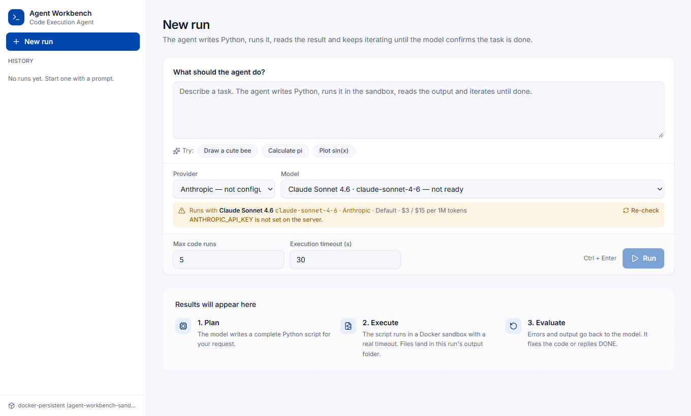

# Agent Workbench

> A hands-on workbench for building, observing, and evaluating code-executing AI agents.

Agent Workbench is a small, readable **code-execution agent** with a web UI. You give it a task in plain language; a model writes Python, a sandbox runs it, and the result (or the error) goes back to the model until it declares the task done or a limit is reached. The point of the project is to make that loop **visible and inspectable**: every model call, code run, retry and artifact is logged, persisted and can be replayed.

It is a learning and showcase project built while studying AI Agent Engineering. **It is not production software** (see [Current limitations](#current-limitations)).



*The new-run screen (a fresh install, so no history and no provider key yet). There is no recorded demo of a full run in this repository.*

## What problem does it solve?

The core of most coding agents is a short loop, but it is easy to hide behind a framework. This project keeps the loop in one place (`agent.py`), keeps "what the model decides" separate from "what the application decides", and gives you the tools to watch it work: live flow, replay, activity logs, run history and downloadable artifacts.

## Features (implemented)

- **Agent loop**: Plan → Execute → Evaluate → Retry/Done, implemented once in `CodeAgent.run()` and shared by the sync API, the SSE API and the Run API.
- **Multiple model providers**, chosen per run and fixed for that run: local Ollama (default: `qwen3.5:4b`), Anthropic Claude and OpenAI (Responses API). The catalog lives in `model_catalog.py`. No automatic fallback between providers.
- **Three executors**: persistent Docker sandbox (default in Compose), ephemeral Docker container per run, and a local subprocess (development only, not isolated; the UI shows a warning).
- **Real timeouts and Stop**: timeout inside the sandbox plus a Python safety net; *Stop* kills the running process, not just the task.
- **Auto `pip install`** for missing modules (persistent sandbox) and **artifact collection** (files and images produced by the code).
- **Run API**: background runs (one at a time), Server-Sent Events, SQLite history that survives restarts, per-run workspace with path-traversal protection.
- **Activity log**: runtime / LLM / model / sandbox entries with secrets redacted before they are stored or sent.
- **Web UI** (React, TypeScript, Vite, Tailwind, shadcn/ui): composer with presets, Live Flow (Agent Studio), Replay of finished runs, Logs, Files/preview, and History.
- **Offline test suite** that uses a scripted planner, so it never calls a paid model API.

## Architecture

```text
Browser (React UI) ──HTTP/SSE──▶ FastAPI server (server.py)
                                      │
                               RunManager (runs.py)   ── SQLite history (store.py)
                                      │                 ── per-run workspace (workspace.py)
                               CodeAgent.run() (agent.py)   ← the single agent loop
                                 │            │
                       LLMPlanner (planner.py)   Executor (executor.py)
                       + provider adapters       Persistent / Ephemeral sandbox / Local
                       (llm_providers.py)
```

The loop, per iteration:

1. **Plan** – the planner streams the selected model's answer: JSON `{thinking, code, language}`. The model decides *what code to write* and *when it is done* (`DONE`).
2. **Execute** – the executor runs the code with a timeout, installs missing packages if needed, and collects artifacts. The application decides this, not the model.
3. **Evaluate** – stdout/stderr/exit code (and a simple "false success" check) are fed back to the model in the next iteration.
4. **Stop** – on `DONE` after at least one successful run, on the run limit, on a timeout, on an error, or when the user presses Stop. `max_iterations` counts **code runs**; if the last run succeeds the model gets one extra *final review* turn whose code is not executed.

More detail: [docs/architecture.md](docs/architecture.md).

## Prerequisites

- **Docker Desktop** (or Docker Engine + Compose v2) for the recommended setup.
- An API key for the provider you want to use (Anthropic and/or OpenAI), **or** [Ollama](https://ollama.com) running locally with a model pulled (no key needed). Anthropic and OpenAI calls are billed by the provider.
- For development without Docker: Python and Node.js. The Docker images use Python 3.11 and Node 22; the offline tests and the UI build were run locally on Python 3.14 and Node 24.

## Quickstart (Docker Compose)

```bash
git clone https://github.com/lehoangpl2020/agent-workbench.git
cd agent-workbench
cp .env.example .env        # then add the key(s) for the provider(s) you use
docker compose up -d --build
```

Open <http://localhost:8000>. Check the stack with `curl http://localhost:8000/health` and `docker compose ps`.

- Port 8000 is bound to `127.0.0.1` only. If it is taken, set `HOST_PORT` in `.env`.
- The Compose project is named `agent-workbench`, with its own container (`agent-workbench-sandbox`), image and volumes, so it does not collide with other Compose projects.
- History and artifacts live in Docker volumes and survive `docker compose down`. `docker compose down -v` deletes them.

> **Security:** the server executes code written by a model and has **no authentication**. It mounts the Docker socket to control the sandbox. Keep it on `127.0.0.1`, and do not expose it to a LAN or the internet.

### Configuring providers

Put keys in `.env` (Compose reads it); never commit that file. Only the providers you use need a key.

| Provider | Configuration |
|---|---|
| Anthropic Claude | `ANTHROPIC_API_KEY` |
| OpenAI | `OPENAI_API_KEY` (optional `OPENAI_BASE_URL`) |
| Ollama (local, default) | no key; `OLLAMA_BASE_URL` defaults to `http://host.docker.internal:11434` in Compose |

The default is Ollama with `qwen3.5:4b` (run `ollama pull qwen3.5:4b` first; the app never pulls models). Pick another provider or model per run in the UI, or via `provider` / `model` in the API. A request that names neither uses the default, and a run never falls back to another model. A missing key, an unreachable Ollama or an unpulled model is reported before the run starts. More: [docs/providers.md](docs/providers.md).

### Rebuilding or recreating the agent

The server image bakes in the root `*.py` files (including `model_catalog.py`) and the built UI, so after changing Python code, the model catalog or anything under `web/`, a restart is not enough: rebuild the image.

```bash
docker compose up -d --build        # rebuild agent-server (and the sandbox if its Dockerfile changed) and recreate what changed
docker compose ps                   # agent-server should become "healthy"
curl http://localhost:8000/health
```

- **History is kept.** Runs and artifacts live in the `agent-db` and `agent-runs` volumes, which survive a rebuild and `docker compose down`. Only `docker compose down -v` deletes them.
- **Changed `.env` or a key?** Recreate without rebuilding: `docker compose up -d --force-recreate agent-server`.
- **Want a clean sandbox** (drops packages the agent installed)? `docker compose up -d --force-recreate sandbox`.
- **Start over completely** (containers only, history kept): `docker compose down`, then `docker compose up -d --build`.
- **Bake builder error** (`additional privileges requested`)? Build the images directly; see [docs/troubleshooting.md](docs/troubleshooting.md).

After the rebuild, check the default model: `ollama list` must show `qwen3.5:4b` on the machine that runs Ollama, and the backend must reach it. From the container: `docker compose exec agent-server curl -s http://host.docker.internal:11434/api/tags`. Then open the UI: the Model field should preselect **Ollama (local) / Qwen 3.5 4B** with a *ready* status, and `qwen3.8:latest` and `gemma4:12b` should be listed as well. The app never pulls models; a model that is not pulled is shown as *Not pulled yet*.

Without Docker, restart `python server.py` after changing Python files or the catalog; `npm run dev` reloads the UI by itself.

### Local development (no Docker, not isolated)

```bash
python -m venv .venv
.venv/Scripts/pip install -r requirements-dev.txt     # Linux/macOS: .venv/bin/pip
# Default: local Ollama with qwen3.5:4b pulled. For Anthropic/OpenAI, export the key instead (billed by the provider).
export ANTHROPIC_API_KEY=...                          # optional
USE_DOCKER=false python server.py                     # API on http://127.0.0.1:8000
cd web && npm ci && npm run dev                       # UI on http://localhost:5173 (proxies to :8000)
```

In this mode model-written code runs on your machine with your user's permissions. `python server.py` does not read `.env`; export variables in your shell.

## Running the tests

```bash
# Backend: offline, scripted planner, no model API calls (code still runs for real via LocalExecutor)
.venv/Scripts/python -m pytest tests -q               # Linux/macOS: .venv/bin/python

# Frontend: type-check + production build (there are no frontend tests yet)
cd web && npm run build
```

The offline tests never contact Ollama, Anthropic or OpenAI (they use mock transports and a scripted planner), so they pass whether or not Ollama is running. A test that needs the real Docker sandbox is skipped by default; see the docstring of `tests/test_docker_executor.py` to enable it. When a real model is needed to check a change, use local Ollama with `qwen3.5:4b`; see [AGENTS.md](AGENTS.md#8-verification-and-contribution-workflow).

## Current limitations

- **Not production-ready.** No authentication, no cost limits, no quality evaluation, and observability is limited to the activity log and UI.
- Only one run at a time.
- The persistent sandbox is shared by all runs; code from one run could in theory read another run's directory. The sandbox has network access (needed for auto-install).
- The server container mounts `/var/run/docker.sock`, which is very powerful on the host.
- Local mode is not isolated.
- No frontend tests; the UI was checked by building it and by manual use.
- Prompts, generated code and stdout are stored unredacted in SQLite.

## Roadmap (planned, not implemented)

These are ideas, not commitments; none of them exist yet:

- Agent-quality evaluation (fixed task sets, pass rate) and per-run token/latency/cost summaries.
- Run comparison and experiment profiles.
- Native tool calling and other loop strategies, memory and context management.
- Human approval steps and stricter sandbox isolation.
- Frontend tests and CI.

## Documentation

- [docs/architecture.md](docs/architecture.md): components, run flow, run statuses, data layout, activity log, Live Flow and Replay.
- [docs/api.md](docs/api.md): HTTP API, CLI client, executor modes, using the agent from Python, security notes.
- [docs/providers.md](docs/providers.md): provider and model catalog, configuration, Ollama connectivity, error codes.
- [docs/troubleshooting.md](docs/troubleshooting.md): common problems and debugging.
- [AGENTS.md](AGENTS.md) and [CLAUDE.md](CLAUDE.md): guidance for contributors and coding agents.

## Origin and attribution

This project **started from practice code of the AI Agent Engineering course by Mentora × ProtonX** (a code-execution agent skeleton: planner, executor, agent loop, FastAPI server, Docker setup). I then extended it while learning: the React web UI, the Run API (background runs, Stop, SSE), SQLite history, per-run workspaces and artifacts, the activity log, multi-provider support (Anthropic, OpenAI, Ollama), localhost-only defaults, the offline test suite and the documentation. The extensions were built with the help of AI coding assistants.

This is **not** an official Mentora or ProtonX project and is not endorsed by them. The starter code is not entirely my own work. See [NOTICE.md](NOTICE.md) for which parts come from where.

## License

**No license is granted yet.** The starter code comes from course material and I found no license text with it, so I have not applied an open-source license to this repository. Until that is clarified, all rights are reserved by the respective authors; viewing the code on GitHub is fine, but please do not assume you may reuse or redistribute it. If you are from Mentora or ProtonX and have questions about this repository, please open an issue.
