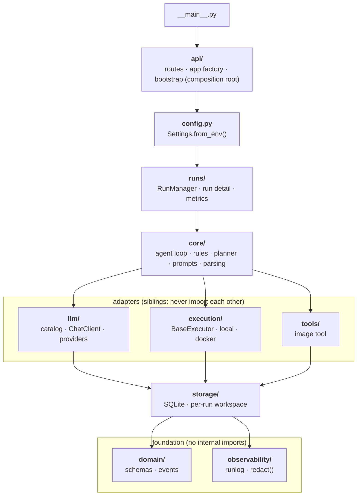

# Project structure

How the repository is organized, which way dependencies are allowed to point, the design principles behind that,
and where new code goes. Read this before adding or moving a module. For how a run works at runtime, see
[architecture.md](architecture.md).

## 1. Top-level layout

```text
agent-workbench/
├── src/agent_workbench/     the backend (Python package, "src layout")
├── tests/                   pytest: unit/, integration/, contract/
├── web/                     the React UI (Vite + TypeScript + Tailwind + shadcn/ui)
├── scripts/                 client.py (CLI client), example.py (the agent without the server)
├── docker/                  server.Dockerfile, sandbox.Dockerfile
├── docs/                    this file, architecture, API, providers, troubleshooting
├── docker-compose.yml       server + sandbox
├── run.sh                   task runner: local | docker | hybrid | web | check | test
├── pyproject.toml           project metadata + pytest settings (puts src/ on the path)
└── requirements*.txt        Python dependencies (installed by Docker and run.sh)
```

Nothing executable lives in the repository root except `run.sh`. The backend is a package with an unambiguous
absolute name (`agent_workbench.core.agent`, not a bare `agent`), so it cannot collide with a library module and
tests import it the same way the server does.

**Why `src/`?** With the package under `src/`, Python only finds it when `src/` is put on the path on purpose
(`pyproject.toml` does it for pytest, `PYTHONPATH=src` for `python -m agent_workbench`, `ENV PYTHONPATH` in the
Docker image). An accidental import of a stray root file is impossible, and the tests run against the same layout
that ships. This is the layout the Python Packaging Authority recommends.

## 2. The backend package

```text
src/agent_workbench/
├── domain/            pure data: no I/O, imports nothing else from the package
│   ├── schemas.py         Pydantic models, ExecutionStatus
│   └── events.py          SSE event names, `flow` tags, payload TypedDicts (the contract with web/src/lib/api.ts)
├── observability/
│   └── runlog.py          activity-log entries, redact() for secrets
├── storage/
│   ├── run_store.py       SQLite: runs, iterations, run_logs (+ migrations)
│   └── workspace.py       one directory per run, path-traversal and symlink guard
├── llm/               adapters to model providers
│   ├── catalog.py         providers, models, the default model (pure data)
│   ├── base.py            the contract: ChatClient, ChatResult, ProviderError + kinds, ProviderSettings
│   ├── anthropic_chat.py  AnthropicChat (official SDK)
│   ├── openai_chat.py     OpenAIChat (Responses API over httpx)
│   ├── ollama_chat.py     OllamaChat (native API over httpx)
│   └── registry.py        ProviderRegistry: readiness, preflight, create(spec) → ChatClient
├── execution/         adapters that run model-written code
│   ├── base.py            BaseExecutor: the shared execute() flow (write code, run, timeout, kill, artifacts)
│   ├── local.py           LocalExecutor: subprocess on the host (dev only, NOT isolated)
│   ├── docker_ephemeral.py  SandboxExecutor: one locked-down container per code run
│   └── docker_persistent.py PersistentSandboxExecutor: `docker exec` into the running sandbox
├── tools/
│   └── image.py           the opt-in image tool the sandboxed code calls through the server
├── core/              the agent itself
│   ├── agent.py           CodeAgent: the single agent loop (Plan → Execute → Evaluate)
│   ├── rules.py           pure stop rules: next_turn, done_outcome, limit_outcome, detect_false_success
│   ├── planner.py         LLMPlanner: one model call (streaming, format retry) → CodeBlock
│   ├── prompts.py         system prompt + conversation builder (pinned by snapshot tests)
│   └── parsing.py         validates the model's JSON reply
├── runs/              application services
│   ├── manager.py         RunManager: background task, one run at a time, Stop, events → SQLite + SSE
│   ├── detail.py          the JSON of GET /api/runs/{id}
│   └── metrics.py         tokens, time and estimated cost of one run
├── config.py          Settings.from_env(): every environment variable, read once
├── api/               delivery layer
│   ├── app.py             create_app(): settings, lifespan, CORS, routers, the built UI
│   ├── bootstrap.py       the composition root: picks the concrete classes and wires them
│   ├── deps.py            helpers shared by the routes (start_run checks, 404/409)
│   ├── sse.py             SSE formatting and queue draining
│   └── routes/            runs.py, system.py, tools.py, legacy.py (one APIRouter each)
└── __main__.py        `python -m agent_workbench` (uvicorn)
```

Each package's `__init__.py` says in one line what the layer is for. `llm/__init__.py` and `execution/__init__.py`
are also **facades**: they re-export the public names, so callers write `from agent_workbench.execution import
LocalExecutor` and do not depend on how the package is split inside.

## 3. The dependency rule

A module may import from **its own package** or from **a lower layer**. It never imports a higher layer, and
packages on the **same layer never import each other**.



The same rule as text, from top to bottom (each layer may use **any** layer below it, not only the next one):

```text
 7  __main__.py
 6  api/            ← the only place that knows every concrete class (bootstrap.py)
 5  config.py
 4  runs/
 3  core/
 2  llm/   execution/   tools/        siblings: independent of each other
 1  storage/
 0  domain/   observability/          siblings: independent of each other
```

Why it matters:

- **A change ripples only upward.** Editing `storage/` can affect `core/` or `api/`; it can never break `domain/`.
  The lower a module, the more stable it must be, and the fewer things it knows.
- **Adapters are swappable.** `core/` sees an executor and a chat client through their contracts. Replacing Docker
  with another sandbox, or adding a provider, does not touch the loop.
- **The core is testable without the outside world.** `core/rules.py`, `core/prompts.py` and `core/parsing.py`
  are pure functions; the loop runs in tests with a `ScriptedPlanner` and a real `LocalExecutor`.

**It is enforced.** [tests/contract/test_layering.py](../tests/contract/test_layering.py) reads every import in the
package with `ast` and fails on an upward or sibling import, and on a package that has no layer yet. Moving a
package to another layer means changing `LAYERS` in that test and this diagram together.

**The composition root.** Only `api/bootstrap.py` decides *which* implementation is used (local or Docker executor,
which providers, whether the image tool is on) and connects the pieces: for example it plugs the image tool into
the executor with `executor.env_providers.append(tool.sandbox_env)`. Everything below it receives its collaborators
from outside. Tests skip the composition root and pass fakes to `create_app()`.

## 4. Design principles applied

Each principle is described first in general, then where this project applies it.

### SRP — Single Responsibility Principle

*A module (or class) should have one reason to change, i.e. answer to one concern.*

- Each provider has its own module (`llm/anthropic_chat.py`, `openai_chat.py`, `ollama_chat.py`): a change in
  OpenAI's streaming format touches one file. Before, three providers and the registry shared one 520-line file.
- Each executor has its own module; `execution/base.py` keeps only the flow they share.
- `core/rules.py` holds *when to stop and with which status*; `core/agent.py` holds *running the loop and emitting
  events*. Changing the final-review rule does not mean reading the event code.
- The API is split into app factory (`app.py`), wiring (`bootstrap.py`) and endpoint groups (`routes/`), instead of
  18 routes and the wiring in one function.

### OCP — Open/Closed Principle

*Code should be open for extension and closed for modification: adding a feature should mean adding code, not
editing working code.*

- `ProviderRegistry.create()` dispatches through a factory table. A new provider is a new `*_chat.py` module plus
  one table entry; the dispatch code itself does not change.
- `build_executor()` picks the sandbox kind from the table `SANDBOX_EXECUTORS`. A new sandbox kind is one factory
  function and one entry.
- Executors accept any number of `env_providers`, so a second tool adds its own provider instead of editing the
  executor.
- New events and `flow` tags are only ever **added** (AGENTS.md invariant 5); the meaning of an existing one never
  changes, so the UI and old runs keep working.

### LSP — Liskov Substitution Principle

*Any subclass must be usable wherever its base class is expected, without the caller checking which one it got.*

- `LocalExecutor`, `SandboxExecutor` and `PersistentSandboxExecutor` all honor `BaseExecutor.execute()`: same
  arguments, same `ExecutionResult`, same timeout and Stop behavior. The agent never checks which one it has.
- `GET /api/config` used to ask `isinstance(executor, LocalExecutor)` to decide "sandboxed". Now each executor
  declares `isolated`, so a new executor reports itself correctly without anyone editing the route.
- In tests, `ScriptedPlanner` replaces `LLMPlanner` and a `BrokenSandbox(BaseExecutor)` replaces a real sandbox;
  the loop cannot tell the difference, which is exactly what makes the tests meaningful.

### ISP — Interface Segregation Principle

*Clients should depend only on the methods they use; prefer small, focused interfaces over one large one.*

- The planner depends on `ChatClient`, which has **one** method, `stream(...)`. It does not see the registry,
  readiness checks or HTTP clients.
- The executor depends on `SandboxEnvFn` (`run_id → env vars`), not on the whole `ImageTool` with its HTTP client,
  quota and file writing.
- An executor subclass implements just `_run()` and `_kill()`; timeouts, cancellation and artifact collection are
  inherited.

### DIP — Dependency Inversion Principle

*High-level policy should not depend on low-level details; both should depend on abstractions, and the details
are supplied from outside.*

- `CodeAgent` receives a planner and a `BaseExecutor`; `LLMPlanner` receives a `ChatClient`. The concrete Docker,
  HTTP and SDK classes are chosen in `api/bootstrap.py` and passed in (dependency injection).
- The executor used to import `tools/image.py` to build `IMAGE_TOOL_URL`. The dependency is now inverted: the
  executor exposes `env_providers`, and the composition root plugs `ImageTool.sandbox_env` into it. The test of
  the layer rule includes this exact case.
- Remaining convenience defaults, stated honestly: `CodeAgent()` without arguments still falls back to a
  `LocalExecutor` and an `LLMPlanner`, so `scripts/example.py` stays short. The server never relies on them.

### Separation of concerns, high cohesion, low coupling

*Keep together what changes together (cohesion); keep apart what changes for different reasons (coupling).*

- The folders follow concerns: data (`domain`), persistence (`storage`), outside systems (`llm`, `execution`,
  `tools`), behavior (`core`), use cases (`runs`), delivery (`api`).
- "What the model decides" (`core/prompts.py`, `core/parsing.py`) is separate from "what the application decides"
  (`core/rules.py`, `execution/`). See the table in [AGENTS.md](../AGENTS.md#2-architecture-and-repository-structure).
- The backend and the UI are coupled only through a declared contract (`domain/events.py` ↔ `web/src/lib/api.ts`),
  checked by `tests/contract/test_event_contract.py`.

### Pure core, effects at the edges

*Keep decisions in pure functions and push I/O (network, disk, processes) to thin outer layers.*

- `core/rules.py`, `core/prompts.py`, `core/parsing.py`, `runs/metrics.py` and `llm/catalog.py` do no I/O, so they
  are tested directly in `tests/unit/` in a few seconds.

### DRY — Don't Repeat Yourself

*Every piece of knowledge should have a single, authoritative place.*

- Settings are read once in `config.py`; the model catalog lives only in `llm/catalog.py` (the UI asks the API for
  it); the start-of-run checks (422/400/409) exist once in `api/deps.py` and serve both the Run API and the legacy
  API; test helpers shared by several files (`make_app`, `ScriptedPlanner`) live in `tests/conftest.py`.

### KISS and YAGNI — what was deliberately *not* done

*Keep it simple; do not build what is not needed yet.*

- No plugin system, entry points or dependency-injection framework: a dict of factories and constructor arguments
  are enough for three providers and three executors.
- No full "ports and adapters" layer of abstract interfaces for every class. Contracts exist where there are
  several implementations (`ChatClient`, `BaseExecutor`) or a test needs a fake.
- **No generic `Tool` interface yet.** There is one tool. Its prompt section (`core/prompts.py`) and the per-run
  opt-in flag (`image_tool` on the request) are still image-specific. When a second tool arrives, that is the moment
  to extract a `Tool` protocol (name, `sandbox_env`, prompt section, opt-in) in `tools/base.py`: designing it from
  two real cases gives a better interface than guessing from one.
- No new dependencies: the layer rule is checked with the standard library (`ast`), not an extra linter.

## 5. How to extend

| To add... | Do this | Do not |
|---|---|---|
| A model of an existing provider | A `ModelSpec(...)` line in `llm/catalog.py` ([providers.md](providers.md#1-adding-or-removing-models-edit-llmcatalogpy)) | Hard-code model lists in the UI |
| <a id="add-a-model-provider"></a>A model provider | 1. `ProviderInfo` + models in `llm/catalog.py`. 2. `llm/<name>_chat.py` with a class that implements `ChatClient.stream()` and maps errors to `ProviderError` kinds. 3. Its key in `ProviderSettings` / `missing_config()` (`llm/base.py`). 4. One entry in the factory table of `ProviderRegistry.create()`. 5. Tests with `httpx.MockTransport` in `tests/integration/test_providers.py` | Branch on the provider name in `core/` |
| A sandbox kind | 1. `execution/<kind>.py`: subclass `BaseExecutor`, implement `_run()` and `_kill()`, set `name` and `isolated`. 2. Export it in `execution/__init__.py`. 3. A factory function + entry in `SANDBOX_EXECUTORS` (`api/bootstrap.py`). 4. A setting value in `config.py` and AGENTS.md | Re-implement timeouts or artifact collection |
| A tool the code can call | 1. `tools/<name>.py` (settings, the server-side call, `sandbox_env(run_id)`). 2. An endpoint in `api/routes/tools.py`. 3. Wire it in `api/bootstrap.py` (`executor.env_providers.append(...)`). 4. Its prompt section. With a second tool, extract the `Tool` protocol first (see YAGNI above) | Give the sandbox an API key; import the tool from `execution/` |
| An endpoint | A function in the right `api/routes/*.py` (or a new router included in `api/app.py`); shared checks go in `api/deps.py`; update `docs/api.md` and `web/src/lib/api.ts` | Put logic in the route that belongs in `runs/` or `core/` |
| A setting | A field in `Settings` (`config.py`) + the table in AGENTS.md §3; pass the value in through `api/bootstrap.py` | Read `os.environ` elsewhere |
| An event, `flow` tag or payload key | Declare it in `domain/events.py`, mirror it in `web/src/lib/api.ts` | Change the meaning of an existing one |
| A new package | Pick its layer, add it to `LAYERS` in `tests/contract/test_layering.py` and to the diagram above | Put a `.py` file in the repository root |

## 6. Tests

```text
tests/
├── conftest.py      ScriptedPlanner, Hang, make_app, wait_until, fake_registry (shared helpers)
├── unit/            one module at a time; no app, no subprocess, no network
├── integration/     the app or the loop end to end: scripted planner + real LocalExecutor subprocess;
│                    Docker only behind DOCKER_SANDBOX_TESTS=1
└── contract/        what other parts rely on: events vs the UI, pinned snapshots (contract/snapshots/),
                     UI fixtures, and the layer rule
```

```bash
.venv/Scripts/python -m pytest tests -q          # everything (Linux/macOS: .venv/bin/python)
.venv/Scripts/python -m pytest tests/unit -q     # fast feedback while editing pure code
```

## 7. Conventions

- **Absolute imports only** (`from agent_workbench.core.rules import next_turn`); relative imports are rejected by
  `test_layering.py`, so every dependency is greppable.
- **Import from the facade** for `llm` and `execution` (`from agent_workbench.llm import ProviderError`); import
  a submodule directly only for something private to it (as `tests/integration/test_docker_executor.py` does).
- Adapter modules are named after what they adapt with a suffix (`anthropic_chat.py`), never after the library
  itself, so they can never shadow the `anthropic` SDK.
- A module's docstring says what it is responsible for and, when useful, what it deliberately does not do.

## 8. Old → new paths

The flat layout before this structure, for reading older commits, issues and [NOTICE.md](../NOTICE.md) (which
records the original file names):

| Before | Now |
|---|---|
| `schemas.py`, `events.py` | `domain/schemas.py`, `domain/events.py` |
| `runlog.py` | `observability/runlog.py` |
| `store.py`, `workspace.py` | `storage/run_store.py`, `storage/workspace.py` |
| `model_catalog.py` | `llm/catalog.py` |
| `llm_providers.py` | `llm/base.py`, `llm/anthropic_chat.py`, `llm/openai_chat.py`, `llm/ollama_chat.py`, `llm/registry.py` |
| `executor.py` | `execution/base.py`, `execution/local.py`, `execution/docker_ephemeral.py`, `execution/docker_persistent.py` |
| `image_tool.py` | `tools/image.py` |
| `agent.py` | `core/agent.py` + `core/rules.py` |
| `planner.py`, `prompts.py`, `parsing.py` | `core/planner.py`, `core/prompts.py`, `core/parsing.py` |
| `runs.py`, `run_detail.py`, `metrics.py` | `runs/manager.py`, `runs/detail.py`, `runs/metrics.py` |
| `config.py` | `config.py` |
| `server.py`, `sse.py` | `api/app.py`, `api/bootstrap.py`, `api/deps.py`, `api/routes/*.py`, `api/sse.py`; `python -m agent_workbench` |
| `client.py`, `example.py` | `scripts/client.py`, `scripts/example.py` |
| `Dockerfile.server`, `Dockerfile.sandbox` | `docker/server.Dockerfile`, `docker/sandbox.Dockerfile` |
| `tests/test_*.py`, `tests/snapshots/` | `tests/{unit,integration,contract}/test_*.py`, `tests/contract/snapshots/` |

Backend paths in the table are relative to `src/agent_workbench/`.
